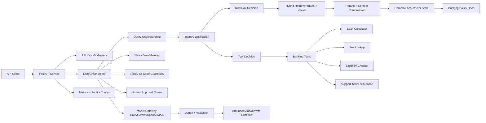

# Agentic Banking Assistant with RAG and Tool Calling

Production-oriented AI banking assistant built for an AI Engineer Fresher/Junior portfolio. It demonstrates controlled agentic RAG, LangGraph orchestration, hybrid retrieval, tool calling, memory, policy guardrails, HITL approval, observability, security evaluation, FastAPI backend design, and practical optimization.

## What It Does

The assistant answers questions about savings accounts, credit cards, personal loans, home loans, fees, eligibility, repayment schedules, and support escalation. It grounds product answers in retrieved bank policy documents and calls tools when the request needs calculation, structured lookup, or rule validation.

## Interview Highlights

This project is designed to be evaluated as an AI backend system, not just as a chat demo:

- Controlled LangGraph agent with planning, retrieval/tool decisions, execution, critic verification, and retry.
- Hybrid RAG using BM25 + vector retrieval, reranking, contextual compression, citations, and retrieval ablation.
- Tool calling for fees, loan repayment, eligibility, branch guidance, support escalation, account summary, transactions, and loan status.
- Consent-aware memory for incomplete multi-turn banking queries, including pending task and slot filling.
- Bank-style safety controls: prompt injection detection, SQL injection simulation, policy-as-code guardrails, RBAC, PII masking/tokenization, audit events, and HITL interrupts.
- Evaluation harnesses for retrieval, groundedness, hallucination, red-team attacks, agentic trajectory, golden regression, Vietnamese queries, messy data, and synthetic customer journeys.
- Production packaging with FastAPI, Docker, CI, GHCR image publishing, and a production compose deploy path.

## Architecture



## Agent Workflow

The LangGraph workflow follows:

1. Query understanding and PII redaction
2. Input policy scan for prompt injection and SQL injection
3. Query rewriting, decomposition, and structured plan creation
4. Intent classification
5. Hybrid retrieval decision
6. BM25 + vector retrieval, reranking, and contextual compression
7. Structured tool routing with expected arguments
8. Tool-use decision with risk scoring and least-privilege scope checks
9. HITL interrupt for high-risk side-effect actions
10. Multi-turn slot memory resolves missing fields and short follow-up replies
11. Model gateway generation with Gemini/Groq/OpenAI/mock fallback
12. Structured validation and critic verification
13. Retry retrieval loop when the critic detects ungrounded evidence
14. Semantic cache write, audit, trace, metrics, and final response

This maps to the agentic pattern: planning -> tool use -> memory -> execution -> verification.

This is intentionally a **controlled agentic RAG system**, not an unconstrained autonomous agent. In banking, tool access is gated by policy, consent, RBAC, risk score, and human approval.

## Tools

- `retrieve_banking_docs(query)`: searches relevant banking policy/product chunks.
- `loan_calculator(amount, rate, months)`: calculates fixed-rate monthly repayment.
- `fee_lookup(product_type, service_name)`: returns structured fee data.
- `eligibility_checker(user_profile, product)`: checks basic eligibility rules and requires human review.
- `create_support_ticket(issue_type, summary)`: simulates escalation with consent guardrail.
- `customer_account_summary(user_profile)`: returns masked synthetic account/card data through a core banking adapter.
- `transaction_search(user_profile, keyword)`: searches detailed synthetic transaction history with consent and audit logging.
- `loan_status_lookup(user_profile)`: returns synthetic loan status, principal, next due amount, DPD, and repayment metadata.
- `branch_finder(province, service)`: returns branch/service-center guidance from detailed mock branch data.

## Bank-Style Integration Readiness

This project does not claim to connect to real Bank systems. Instead, it implements a realistic adapter boundary that can be replaced by an authenticated bank API gateway later:

- `MockCoreBankingAdapter` simulates core banking reads for customers, accounts, credit cards, loans, transactions, and branches.
- Product, policy, tool, and mock-core data are now Vietnam/Bank-style and denominated in VND for portfolio alignment.
- Realistic messy fixtures include partial KYC, dormant accounts, negative balances, duplicate transactions, pending authorizations, standalone fees, delinquent/restructured loans, and stale branch metadata.
- PII redaction masks phone numbers, card numbers, account numbers, national id, and email before LLM generation.
- Privacy Vault tokenizes PII before LLM processing and keeps scoped mappings outside prompts.
- Role-based access control separates anonymous product Q&A from authenticated customer data workflows.
- Consent checks block account, transaction, loan-status, and support workflows until consent is confirmed.
- Audit events record actor id, role, action, purpose, consent status, PII categories, status, and safe metadata.
- Personal-data tools return masked account identifiers and structured data instead of raw customer records.

For a real bank integration, replace `app/services/mock_core.py` with signed API calls to an API gateway or core banking service, keep the same tool contracts, and enforce bank IAM, consent, rate limits, and audit retention policies.

## Optimizations Included

- Hybrid retrieval with BM25 + vector search and reciprocal-rank-style fusion.
- MMR diversification and provenance metadata for explainable retrieval selection.
- Lightweight reranking interface that can be replaced by a cross-encoder reranker.
- Query rewriting and decomposition for multi-intent banking questions.
- Token budget control through `MAX_CONTEXT_CHARS` contextual compression.
- Adaptive token budgeting that changes top-k and context size by intent and workflow risk.
- Tool-output compaction to avoid sending verbose personal-data payloads to the model.
- Cost tracking for provider tokens, estimated cost, cache hit rate, and compression ratio.
- Semantic caching with embedding similarity plus lexical similarity guard.
- Cached in-process conversation memory and reusable vector store.
- Consent-aware persistent memory stores conversation preferences, slots, pending tasks, and history only when `consent_confirmed=true`.
- Async FastAPI `/chat` endpoint and async LangGraph execution.
- Small deterministic hash embeddings for local demos; Chroma can be swapped to a paid embedding model later.
- Retrieval ablation study compares hybrid default, vector-heavy, BM25-heavy, high-recall, and compressed retrieval profiles.

## Enterprise AI Controls

- Structured outputs with Pydantic schemas for agent plans and answer validation.
- Structured tool-routing and critic-review schemas for trajectory-level inspection.
- Policy-as-code guardrails in `data/policies/guardrails.yml`.
- RAGAS-lite hallucination harness for faithfulness, context precision, citation precision, numeric consistency, and unsupported-refusal scoring.
- Prompt injection and SQL injection detectors before retrieval/tool execution.
- Tool risk scoring for low/medium/high-risk workflows.
- Least-privilege tool scopes through role-based access control.
- HITL approval queue for high-risk side-effect workflows.
- Model gateway abstraction for Gemini, Groq, OpenAI-compatible APIs, and local fallback.
- Local trace recorder with `/traces` endpoint; shape is ready to map to OpenTelemetry/LangSmith.
- Optional OpenTelemetry OTLP export through `OTEL_ENABLED=true` and `OTEL_EXPORTER_OTLP_ENDPOINT`.
- `/audit` endpoint for personal-data tool access events.
- `/approvals` endpoint for pending human review requests.
- Privacy Vault stats endpoint for tokenization observability.
- Proactive insight engine for fee avoidance, balance, and loan due-date nudges.
- Next-best-action engine with risk levels and action lifecycle states.
- Feedback loop for missing-content and escalation gap mining.
- Multi-turn slot-filling memory for incomplete loan and eligibility workflows.
- Persistent memory policy prevents writing long-term memory to disk without consent.
- Vietnamese banking query support for intent routing, slot filling, tool selection, and injection blocking.
- Data-quality flagging and caveats for missing, stale, duplicate, pending, dormant, frozen, and delinquent records.

## Safety and Guardrails

The assistant:

- Refuses unsupported personalized financial advice.
- Avoids invented rates, fees, and eligibility conditions.
- States when information is missing from documents.
- Asks for missing calculator or eligibility fields.
- Marks eligibility and support actions as requiring human review.

## Repository Structure

```text
app/
  agent/          LangGraph state machine
  api/            API auth dependencies
  core/           settings and logging
  services/       RAG, vector store, LLM, memory, metrics
  tools/          callable banking tools
data/
  docs/           sample banking policy/product documents
  eval_questions.jsonl
scripts/
  build_eval_dataset.py    regenerate 90-case VND/Vietnam evaluation dataset
  end_user_smoke_test.py   official end-user journey smoke test through /chat
  evaluate.py              offline RAG/tool evaluation runner
  evaluate_retrieval_ablation.py retrieval profile comparison
  evaluate_security.py     red-team, prompt injection, golden answer, journey harness
  evaluate_hallucination.py RAGAS-lite groundedness and hallucination benchmark
  evaluate_ragas.py        optional real RAGAS evaluation with Groq/OpenAI judge
  evaluate_agentic.py      trajectory, tool, argument, goal, policy, critic evaluation
  evaluate_product_intelligence.py token compaction, insights, actions, content gaps
  evaluate_memory.py       multi-turn clarification and slot-filling evaluation
  evaluate_messy_data.py   messy banking data quality evaluation
  evaluate_vietnamese.py   Vietnamese intent, tool, guardrail, and memory evaluation
  load_test_chat.py        lightweight concurrent /chat load test
  generate_evaluation_report.py combined Markdown report generator
.github/
  workflows/ci.yml         pytest, offline eval, optional manual RAGAS job
  workflows/cd.yml         GHCR Docker image publish and optional VPS deploy
docs/
  ARCHITECTURE.md
  SECURITY_MODEL.md
  DEMO_SCRIPT.md
  DEPLOYMENT.md
reports/
  EVALUATION_REPORT.md
tests/
  test_tools.py
  test_api.py
  test_security_harness.py
  test_vietnamese_support.py
```

## Setup

```bash
python -m venv .venv
. .venv/Scripts/activate  # Windows PowerShell: .venv\Scripts\Activate.ps1
pip install -e ".[dev]"
cp .env.example .env
uvicorn app.main:app --reload
```

Open:

- Health: `GET http://localhost:8000/health`
- Metrics: `GET http://localhost:8000/metrics`
- Audit: `GET http://localhost:8000/audit`
- Traces: `GET http://localhost:8000/traces`
- HITL approvals: `GET http://localhost:8000/approvals`
- Privacy Vault stats: `GET http://localhost:8000/privacy-vault/stats`
- Insights: `GET http://localhost:8000/insights?customer_id=CUST1001`
- Actions: `GET/POST http://localhost:8000/actions`
- Feedback: `GET/POST http://localhost:8000/feedback`
- Memory: `GET http://localhost:8000/memory/{conversation_id}`
- Docs: `http://localhost:8000/docs`

Use header:

```text
X-API-Key: dev-secret
```

## Five-Minute Demo

Use `docs/DEMO_SCRIPT.md` for the recommended interview flow:

1. Product RAG + fee lookup.
2. Loan calculator with missing-slot clarification.
3. Personal data blocked without role/consent.
4. Personal data allowed with authenticated customer profile.
5. Prompt injection blocked before tools/retrieval.
6. Support ticket routed to HITL approval.
7. Evaluation evidence through smoke, retrieval, and security harnesses.

Quick verification:

```bash
python scripts/end_user_smoke_test.py
python scripts/evaluate.py
python scripts/evaluate_security.py
```

## API Examples

Ingest documents:

```bash
curl -X POST "http://localhost:8000/ingest" \
  -H "X-API-Key: dev-secret" \
  -H "Content-Type: application/json" \
  -d "{\"reset\": true}"
```

Ask a product question:

```bash
curl -X POST "http://localhost:8000/chat" \
  -H "X-API-Key: dev-secret" \
  -H "Content-Type: application/json" \
  -d "{\"conversation_id\":\"demo-1\",\"message\":\"What is the credit card annual fee waiver condition?\"}"
```

Call a repayment workflow:

```bash
curl -X POST "http://localhost:8000/chat" \
  -H "X-API-Key: dev-secret" \
  -H "Content-Type: application/json" \
  -d "{\"conversation_id\":\"demo-2\",\"message\":\"Calculate a 100000 VND loan at 6 percent for 24 months\"}"
```

Check eligibility:

```bash
curl -X POST "http://localhost:8000/chat" \
  -H "X-API-Key: dev-secret" \
  -H "Content-Type: application/json" \
  -d "{\"conversation_id\":\"demo-3\",\"message\":\"Am I eligible for a home loan?\",\"user_profile\":{\"age\":25,\"monthly_income\":30000,\"employment_months\":18}}"
```

## Running Tests

```bash
pytest
```

## Evaluation

Run:

```bash
python scripts/evaluate.py
python scripts/evaluate_retrieval_ablation.py --limit 50
python scripts/evaluate_security.py
python scripts/evaluate_hallucination.py
python scripts/evaluate_ragas.py --prepare-only
python scripts/evaluate_agentic.py
python scripts/evaluate_product_intelligence.py
python scripts/evaluate_memory.py
python scripts/evaluate_messy_data.py
python scripts/evaluate_vietnamese.py
python scripts/generate_evaluation_report.py
```

Evaluation set: 90 English/Vietnamese VND banking questions plus dedicated security, hallucination, agentic trajectory, memory, messy-data, and customer-journey suites.

Retrieval ablation:

```bash
python scripts/evaluate_retrieval_ablation.py --limit 50
```

The ablation compares hybrid default, vector-heavy, BM25-heavy, high-recall top-k, and compressed-context variants using retrieval hit rate, intent accuracy, tool success, token usage, and latency.

Security harness:

- 12 adversarial red-team cases.
- 8 golden answer regression cases.
- 4 synthetic customer journey tests.
- Prompt injection benchmark and SQL injection simulation.
- Local LLM-as-judge style scoring for groundedness, safety, and helpfulness.
- Dataset version metadata in `data/eval/dataset_version.json`.

Hallucination harness:

- Claim-level faithfulness against retrieved chunks and tool outputs.
- Numeric consistency checks for rates, fees, balances, and thresholds.
- Citation precision checks that cited chunks come from retrieved evidence.
- Unsupported-question refusal for missing rate tables, guarantee-approval prompts, and false-premise questions.
- RAGAS-lite metrics without requiring paid judge calls for deterministic CI-style regression.

Real RAGAS evaluation:

```bash
pip install -e ".[ragas]"

# Uses GROQ_API_KEY through Groq's OpenAI-compatible endpoint.
python scripts/evaluate_ragas.py --judge-provider groq --app-provider groq

# If you also set OPENAI_API_KEY, the script can include answer_relevancy embeddings.
python scripts/evaluate_ragas.py --judge-provider openai --app-provider groq
```

The real RAGAS script prepares columns compatible with both common RAGAS dataset schemas: `question`, `answer`, `contexts`, `ground_truth` and `user_input`, `response`, `retrieved_contexts`, `reference`. Metrics include faithfulness and context precision by default; answer relevancy is added when embeddings are available.

Load test:

```bash
python scripts/load_test_chat.py --url http://localhost:8000/chat --requests 50 --concurrency 10
```

CI:

- `.github/workflows/ci.yml` runs pytest, end-user smoke test, dataset build, offline eval, hallucination, agentic, memory, messy-data, Vietnamese, retrieval ablation checks, and Docker image build validation.
- Real RAGAS is a manual workflow job because it requires `GROQ_API_KEY` and external judge calls.

Agentic evaluation harness:

- Expected trajectory adherence across graph nodes.
- Tool correctness against expected tools.
- Argument correctness for tool inputs.
- Policy correctness against expected guardrail flags.
- Goal completion scoring for answered, blocked, tool-executed, and HITL-pending outcomes.
- Critic pass-rate scoring for final agent verification.

Example report table for README/CV. Replace placeholders after running on your machine or with a real LLM:

| Metric | Target | Current/Placeholder |
|---|---:|---:|
| Evaluation dataset size | 80-100 cases | 90 cases |
| Retrieval top-k accuracy | >= 85% | 96.67% |
| Intent classification accuracy | >= 85% | 98.89% |
| Faithfulness / groundedness proxy | >= 90% | 100.00% |
| Average response latency | <= 1000 ms local fallback | 39.84 ms |
| Average token usage | track only | 783.46 tokens |
| Tool-call success rate | >= 95% | 100.00% |
| Red-team pass rate | >= 90% | 100.00% |
| Hallucination benchmark pass rate | >= 90% | 100.00% / 8 cases |
| Real RAGAS faithfulness/context precision | track with judge LLM | 100.00% / 100.00% |
| Real RAGAS answer relevancy | track with judge LLM | 100.00% |
| Retrieval ablation best variant | inspect tradeoff | vector_heavy |
| Numeric consistency | 100% | 100.00% |
| Unsupported refusal rate | >= 95% | 100.00% |
| Golden regression pass rate | >= 85% | 100.00% |
| Synthetic journey pass rate | >= 90% | 100.00% |
| Agentic trajectory adherence | >= 90% | 100.00% |
| Tool correctness | >= 95% | 100.00% |
| Argument correctness | >= 90% | 100.00% |
| Agent goal completion | >= 90% | 100.00% |
| Overall agentic score | >= 90% | 100.00% |
| Tool payload compaction ratio | <= 65% | 55.39% |
| Proactive insight count | >= 2 | 3 |
| Recommended action count | >= 2 | 3 |
| Multi-turn slot-fill success | 100% | 2/2 cases |
| Vietnamese intent/tool/guardrail/memory score | >= 90% | 100.00% / 7 cases |
| Messy data quality flags | >= 10 | 19 |

## Docker

Local deterministic demo:

```bash
docker compose up --build
```

The API runs at `http://localhost:8000`.

Production-style compose using a published image:

```bash
export IMAGE_NAME=ghcr.io/<owner>/<repo>:latest
docker compose -f docker-compose.prod.yml up -d
```

The production compose file persists Chroma data and consent-aware memory in Docker volumes, uses the app `/health` endpoint as a container healthcheck, and reads secrets from `.env`.

CD:

- `.github/workflows/cd.yml` builds and pushes Docker images to GitHub Container Registry on `main`, version tags, or manual dispatch.
- Optional manual VPS deploy uses `VPS_HOST`, `VPS_USER`, `VPS_SSH_KEY`, and `VPS_APP_DIR` secrets.
- Full deployment steps are documented in `docs/DEPLOYMENT.md`.

End-user smoke test:

```bash
python scripts/end_user_smoke_test.py
```

## LLM Configuration

Default mode is local/mock for repeatable demos:

```env
LLM_PROVIDER=mock
```

For Gemini 2.5 Flash:

```env
LLM_PROVIDER=gemini
GEMINI_API_KEY=your_key
GEMINI_MODEL=gemini-2.5-flash
```

For Groq Llama:

```env
LLM_PROVIDER=groq
GROQ_API_KEY=your_key
GROQ_MODEL=llama-3.3-70b-versatile
GROQ_BASE_URL=https://api.groq.com/openai/v1
```

For higher free-tier throughput, check your Groq console rate limits and consider swapping `GROQ_MODEL` to a smaller model such as `llama-3.1-8b-instant`.

For OpenAI-compatible generation:

```env
LLM_PROVIDER=openai
OPENAI_API_KEY=your_key
OPENAI_MODEL=gpt-4o-mini
```

The code keeps retrieval/tooling deterministic, so evaluation can run without an external model.

## Limitations

- Banking documents, customer records, branch data, transactions, and fees are synthetic Bank/Vietnam-style fixtures, not official Bank data.
- The mock core banking adapter demonstrates the integration boundary, but a real deployment would need a signed API gateway, bank IAM, audit retention, rate limits, and incident runbooks.
- Chroma local persistence is suitable for portfolio demos; production should use a highly available vector database such as managed Qdrant, pgvector, or an internal retrieval service.
- Hash embeddings are cost-efficient and deterministic for local evaluation, but production retrieval quality should be validated with bank-approved embedding models and SME-labeled datasets.
- Groq/Gemini/OpenAI-compatible providers are useful for demos. Real bank PII should go through a private model gateway, VPC/on-prem model, DPA-approved vendor path, or strict PII tokenization/masking before external calls.
- Fine-tuning alone does not solve privacy. Privacy comes from data minimization, access control, encryption, PII redaction/tokenization, consent policy, audit logging, and isolated model deployment.
- Policy-as-code guardrails and regex detectors are defense-in-depth, not a replacement for enterprise DLP, IAM, transaction signing, fraud controls, and human approval workflows.
- Eligibility checks are preliminary rule checks only and never approval decisions.
- Support ticket creation is simulated and intentionally gated behind human approval.
- RAGAS and hallucination datasets are mostly synthetic. For production readiness, they should be extended with SME-labeled golden answers, real policy revisions, and adversarial cases from bank risk teams.

## Bank Privacy Positioning

If asked whether a bank should use a fine-tuned model to avoid leaking customer data, the answer is:

- Fine-tuning is not the main privacy control. It can improve domain style or task behavior, but it does not automatically prevent data leakage.
- A bank would usually prioritize private deployment, VPC/on-prem inference, strict IAM, encryption, audit logging, DLP, PII minimization, prompt/output filtering, and tool-level authorization.
- RAG is preferable for changing policy/product knowledge because documents can be updated, versioned, audited, and retrieved with citations without retraining a model.
- Fine-tuning may be used later for intent routing, Vietnamese banking language, summarization style, or policy-compliant response patterns, using sanitized and approved datasets.
- This demo uses Groq/mock providers for cost and speed. The architecture isolates the provider behind `ModelGateway` so the same backend can be moved to a bank-approved model endpoint.

